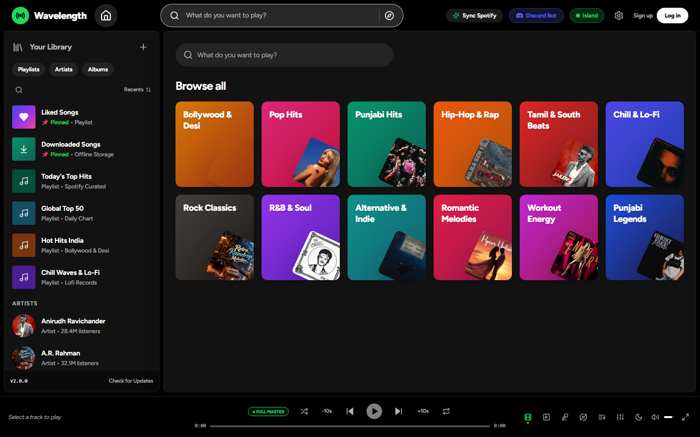
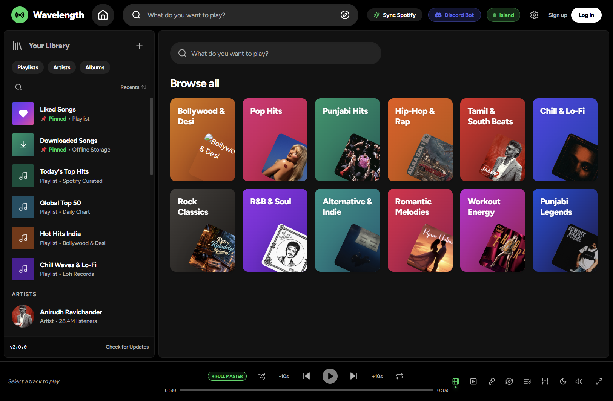
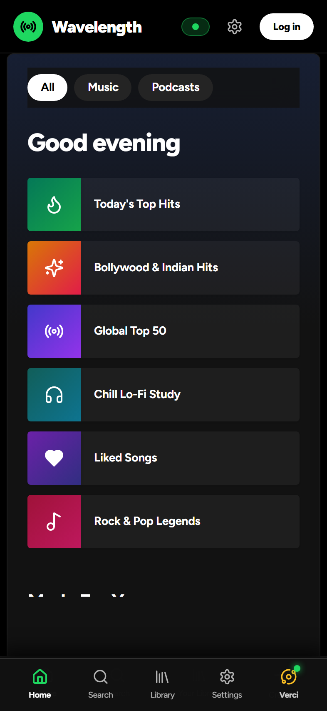
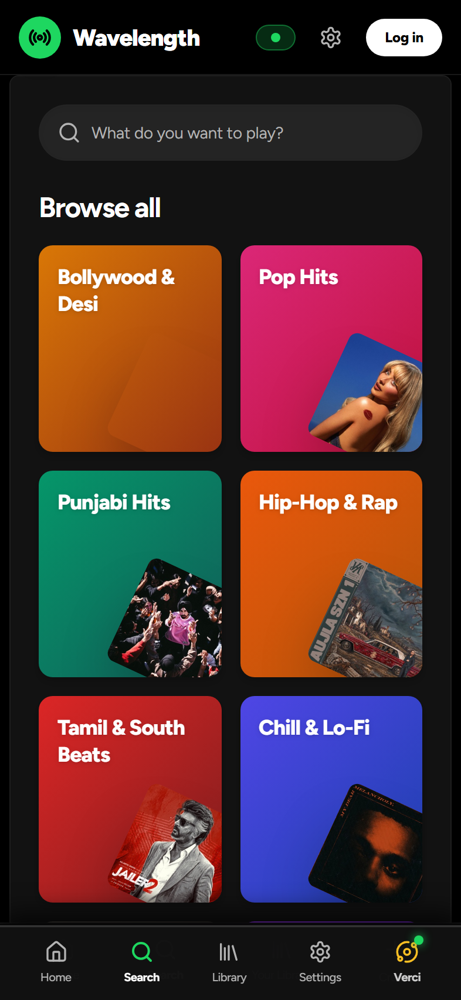
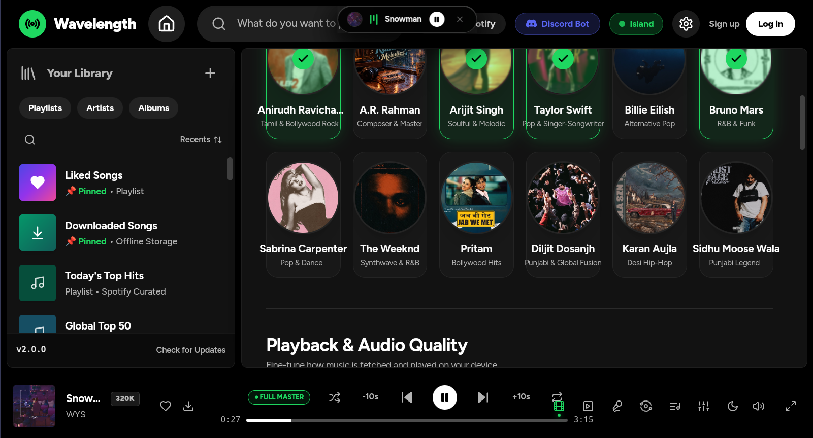

# Wavelength 🎧

> Wavelength is a music player for the web, Android, and Windows, with a companion Discord music bot.

---

## ⚡ Quick Access & 1-Click Downloads

| Platform | Type | Size | Description | Instant Link |
| :--- | :--- | :--- | :--- | :--- |
| **🌐 Web Player** | Browser App | Instant | Full Spotify-grade web experience, live everywhere with zero setup. | [▶️ **Launch Web Player**](https://mohamednavith.github.io/Spotify-Craft/) |
| **🤖 Discord Bot** | Bot Service | 24/7 Cloud | 320kbps master audio, DSP filters (8D, Bass, Nightcore), universal links. | [➕ **Add Bot to Discord**](https://discord.com/oauth2/authorize?client_id=1563521762656780299&permissions=8&scope=bot%20applications.commands) |
| **📱 Android APK** | Mobile App | 4.2 MB | Dynamic Island, gesture swipe, lock-screen controls, 100% ad-free audio. | [⬇️ **Download APK**](https://github.com/MohamedNavith/Spotify-Craft/releases/download/v2.0.0/wavelength-mobile.apk) |
| **💻 Windows PC (Portable EXE)** | Desktop App | 80.1 MB | Single-file Windows player with media key shortcuts. | [⬇️ **Download Windows EXE**](https://github.com/MohamedNavith/Spotify-Craft/releases/download/v2.0.0/wavelength-desktop.exe) |
| **💻 Windows PC (Portable)** | Desktop App | 115.2 MB | Unzip the folder and launch Wavelength.exe. | [⬇️ **Download Portable ZIP**](https://github.com/MohamedNavith/Spotify-Craft/releases/download/v2.0.0/wavelength-windows-x64.zip) |

---

## Interface gallery

| Browse on the web | Browse in the Windows app |
| --- | --- |
|  |  |

| Mobile web home | Mobile web search |
| --- | --- |
|  |  |

**Android APK in landscape** · Artist preferences and playback settings in BlueStacks.

The mobile web images use a 393 × 852 CSS-pixel browser viewport. The Android image comes from the installed APK. The APK attached to the v2.0.0 release reports version 1.4.0 (code 3) to Android.

## Playback quality

Settings lets you select a preferred audio quality. The stream supplied by the provider, the output device, and the operating system determine what you hear. A quality selection alone does not verify the codec, sample rate, or bit-perfect output.

### 📱 Fluid Mobile Architecture & Gesture Engine
- **Back Button & Hierarchical Modal Dismissal**: Integrated `@capacitor/app` native listener. Pressing back dismisses active sheets (Now Playing, Lyrics, Quality Modal, Queue, Equalizer), navigates back through previously viewed tabs (`router.back()`), and requires a confirmed double-press on root Home to exit the app.
- **Deck Swipe & Isolated Scrubber**: Horizontal track skipping is scoped strictly to the central album artwork deck, eliminating conflicts with timeline seeking and volume sliders.
- **Pull-Down Sheet Collapse**: Natural downward drag gesture from the top bar smoothly minimizes full-screen player back to floating mini player.
- **Instant Haptic Touch Feedback**: Integrated micro-vibrations for all interactive player controls.

### 🤖 Enterprise Discord Music Bot (`Wavelength#9248`)
- **Discord voice playback**: 48kHz stereo via native `libopus` with Discord DAVE E2EE protocol support.
- **Hardware-Level DSP Audio Suite**:
  - `!bass` — Punchy sub-bass boost (Low / Med / High)
  - `!8d` — Dynamic 360-degree rotating binaural spatial audio
  - `!nightcore` — Accelerated pitch and tempo boost
  - `!vaporwave` — Slowed + reverb aesthetic soundscape
  - `!karaoke` — Center-channel vocal reduction
- **Universal Link Support**: Paste any Spotify track, playlist, album, or YouTube link directly.
- **Dedicated Request Channels (`/setup`)**: Automatically creates an interactive song request channel like Hydra/Rythm with persistent playback controls.
- **Custom Multi-Prefix Engine**: Default `!` (e.g. `!play`, `!skip`, `!volume`), fully customizable with `!prefix <symbol>`.

---

## ⌨️ Desktop Shortcuts

| Key | Action |
| :--- | :--- |
| `Space` | Play / Pause |
| `Ctrl` + `Right` | Skip to Next Track |
| `Ctrl` + `Left` | Return to Previous Track |
| `Right` / `Left` | Seek Forward / Backward 5s |
| `Up` / `Down` | Adjust Volume ±5% |
| `M` | Mute / Unmute Audio |
| `L` | Like Track / Save to Favorites |
| `S` | Toggle Shuffle |
| `R` | Cycle Repeat (Off / All / One) |
| `Q` | Open / Close Play Queue |

---

## 📄 License & Terms

Wavelength is distributed under the MIT License. Streaming is performed strictly according to authorized API licenses and fair use principles.
