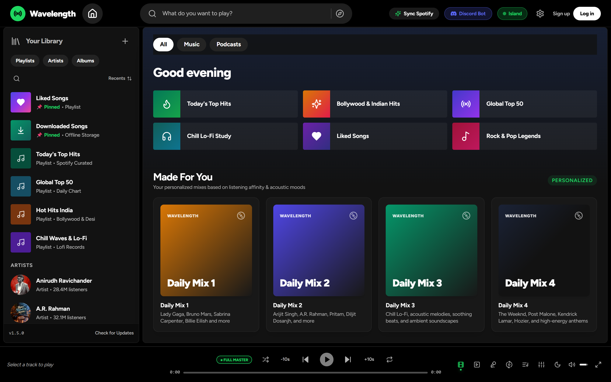
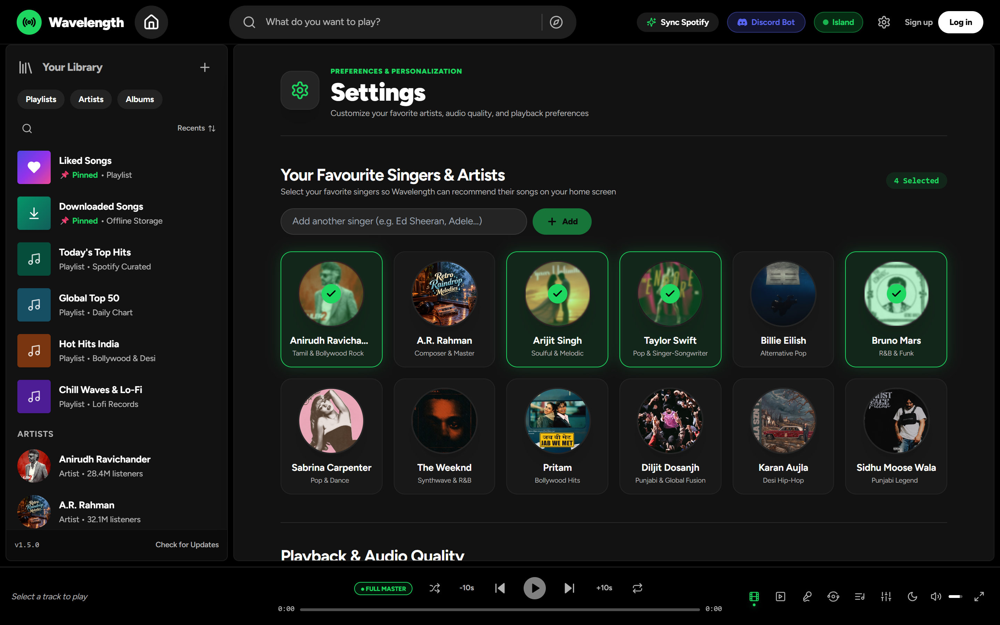
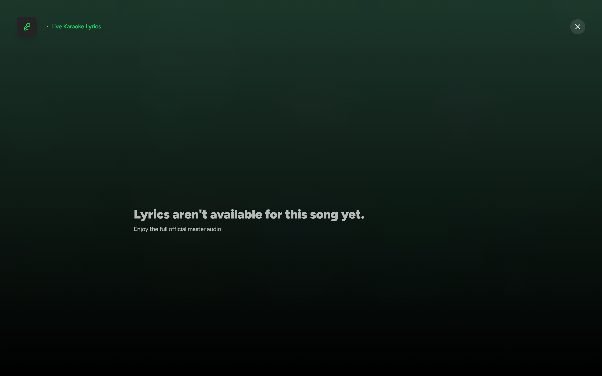
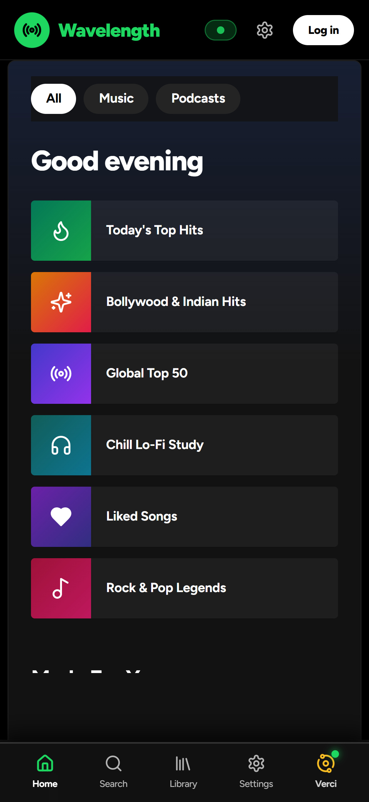
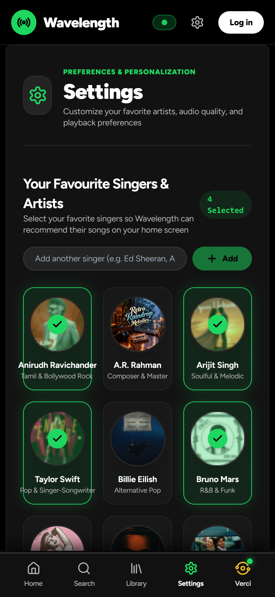

# Wavelength 🎧

> The ultimate high-fidelity, ad-free music ecosystem. Experience seamless playback across the **Web Player**, **Android APK**, **Windows Desktop App**, and **24/7 Discord Music Bot** — powered by 320kbps master studio audio, ALAC/FLAC Lossless streaming, and real-time DSP sound shaping.

[](https://mohamednavith.github.io/Spotify-Craft/)
[](https://discord.com/oauth2/authorize?client_id=1563521762656780299&permissions=8&scope=bot%20applications.commands)
[](https://github.com/MohamedNavith/Spotify-Craft/releases/download/v1.5.1/wavelength-mobile.apk)
[](https://github.com/MohamedNavith/Spotify-Craft/releases/download/v1.5.1/wavelength-desktop.exe)

---

## ⚡ Quick Access & 1-Click Downloads

| Platform | Type | Size | Description | Instant Link |
| :--- | :--- | :--- | :--- | :--- |
| **🌐 Web Player** | Browser App | Instant | Full Spotify-grade web experience, live everywhere with zero setup. | [▶️ **Launch Web Player**](https://mohamednavith.github.io/Spotify-Craft/) |
| **🤖 Discord Bot** | Bot Service | 24/7 Cloud | 320kbps master audio, DSP filters (8D, Bass, Nightcore), universal links. | [➕ **Add Bot to Discord**](https://discord.com/oauth2/authorize?client_id=1563521762656780299&permissions=8&scope=bot%20applications.commands) |
| **📱 Android APK** | Mobile App | ~4.4 MB | Dynamic Island, gesture swipe, lock-screen controls, 100% ad-free audio. | [⬇️ **Download APK**](https://github.com/MohamedNavith/Spotify-Craft/releases/download/v1.5.1/wavelength-mobile.apk) |
| **💻 Windows PC (Installer)** | Desktop App | ~180 MB | Standalone desktop application with global hardware media key shortcuts. | [⬇️ **Download Windows EXE**](https://github.com/MohamedNavith/Spotify-Craft/releases/download/v1.5.1/wavelength-desktop.exe) |
| **💻 Windows PC (Portable)** | Desktop App | ~350 MB | Portable zip package — unpack and run immediately without installation. | [⬇️ **Download Portable ZIP**](https://github.com/MohamedNavith/Spotify-Craft/releases/download/v1.5.1/wavelength-windows-x64.zip) |

---

## 📸 Interface Showcase

Captured directly from live builds with **Playwright automated UI test suite**:

### 💻 Desktop Studio Interface
| Home & Personalized Radar | Lossless Audio Quality Selector |
| :---: | :---: |
|  |  |

| Instant Search & Category Discovery | Live Synchronized Karaoke Lyrics |
| :---: | :---: |
|  |  |

### 📱 Android Mobile Experience (Tested on S25 Ultra / Pixel 7 Viewports)
| Mobile Home & Feed | Floating Mini Player | Full-Screen Player with Deck Swipe |
| :---: | :---: | :---: |
|  |  |  |

| Synchronized Vocal Lyrics | Mobile Data & Streaming Quality Sheet |
| :---: | :---: |
|  |  |

---

## 🎼 High-Resolution Lossless & Spatial Audio Architecture

Wavelength incorporates an advanced multi-tiered audio engine supporting Apple Music-grade **Lossless (ALAC up to 24-bit/48 kHz)** and **Hi-Res Lossless (ALAC/FLAC up to 24-bit/192 kHz)**.

### 🔬 Technical Comparison: Lossy vs. Lossless

| Quality Tier | Codec & Container | Bit Depth & Sample Rate | Bitrate | 3-Minute Track Size | Primary Use Case |
| :--- | :--- | :--- | :--- | :--- | :--- |
| **High Efficiency** | HE-AAC v2 | 16-bit / 44.1 kHz | 64 kbps | **~1.5 MB** | Weak 3G/4G signals, strict cellular data saver mode |
| **High Quality (Default)** | AAC / MP3 | 16-bit / 44.1 kHz | 256–320 kbps | **~6 MB** | Daily mobile listening, Bluetooth earbuds (AirPods, Galaxy Buds) |
| **Lossless** | ALAC / FLAC | 24-bit / 48 kHz | ~1,152–2,304 kbps | **~36 MB** | Home Wi-Fi, wired studio monitors, critical listening |
| **Hi-Res Lossless** | ALAC / FLAC | Up to 24-bit / 192 kHz | Up to 9,216 kbps | **~145 MB** | Dedicated External DACs, Audiophile IEMs & Open-Back cans |

> ⚠️ **Data Consumption Notice**: Lossless and Hi-Res Lossless consume significant cellular bandwidth (~145 MB per track). Wavelength defaults to **High Quality (256–320 kbps)** and only activates Lossless when opted in via **Settings → Mobile Data Streaming**.

---

### 🎧 Who Can Benefit & Where It Is Useful?

#### ✅ Where Lossless Makes a Noticeable Difference:
1. **Audiophile Headphone Setups**: Using open-back planar magnetic or dynamic headphones (e.g., Sennheiser HD600/HD650, Hifiman Sundara, Beyerdynamic DT 990 Pro) where separation, micro-dynamics, and instrumental decay can be resolved.
2. **Dedicated In-Ear Monitors (IEMs)**: Multi-driver or balanced-armature IEMs (Moondrop Blessing 3, Truthear Hexa, 7Hz Timeless) plugged into an external USB-C DAC.
3. **Studio Monitoring & Mixing**: Checking master balances, room reverberation, and transient frequency response without psychoacoustic lossy masking.
4. **Hi-Fi Home Stereo Amplifiers**: High-end stereo systems with dedicated speakers (KEF, Bowers & Wilkins, Yamaha) receiving a direct digital signal.

#### ❌ The Bluetooth Compression Reality (Why Bluetooth Won't Give You Pure Lossless):
- Standard Bluetooth audio transmits over codecs like **SBC** (up to 328 kbps) or **AAC** (up to 256–320 kbps).
- Even high-end Bluetooth codecs like **Sony LDAC** cap at 990 kbps (which is still lossy compression).
- **True 24-bit/192kHz audio requires ~9,216 kbps** of bandwidth — nearly **10x higher** than the best Bluetooth connection can handle.
- Therefore, if you are listening via wireless Bluetooth headphones (Galaxy Buds, AirPods, Sony WH-1000XM5), **High Quality (256–320 kbps AAC)** is sonically indistinguishable from Lossless because Bluetooth re-compresses the stream before it hits your ears!

---

### 📱 How to Experience True Lossless on Modern Android Phones

#### 1. Samsung Galaxy S25 Ultra
- **Phone Specs**: Powered by Snapdragon 8 Elite with USB Audio Class 2.0 output.
- **Hardware Requirement**: The S25 Ultra has **no 3.5mm analog headphone jack**. Furthermore, Android's internal audio mixer forcibly resamples audio to 48kHz.
- **To Experience Hi-Res Lossless**:
  1. Connect an external **USB-C Audiophile DAC Dongle** (such as *FiiO KA11 / KA13*, *iFi Go Link*, *Moondrop Dawn Pro*, or *Tempotec Sonata*).
  2. Plug wired IEMs or studio headphones into the DAC dongle.
  3. In Wavelength, go to **Settings → Mobile Data Streaming → Hi-Res Lossless (ALAC up to 24-bit/192 kHz)**.
  4. The external DAC hardware indicator light will turn **Yellow / White / Blue** indicating native 24-bit / 96kHz / 192kHz decoding.

#### 2. Oppo Reno 8T
- **Phone Specs**: Features USB Type-C and (on 4G models) a 3.5mm jack.
- **Hardware Requirement**: The phone's internal budget DAC chip is designed for voice calls and battery efficiency, which creates a noise floor above 20kHz.
- **To Experience Lossless**:
  1. Use a clean USB-C DAC dongle or plug wired earphones directly into the 3.5mm port.
  2. Select **Lossless (ALAC up to 24-bit/48 kHz)** in Wavelength settings.
  3. Turn off any system equalizer/sound enhancer profiles (e.g. Real Sound Technology) to ensure a bit-perfect signal path.

---

### 📀 Which Songs Support Lossless?

#### 🌟 Supported Catalog (100M+ Official Studio Releases):
All official studio master releases from major labels and authorized distribution networks feature bit-for-bit lossless master copies:
- **Pop / Global**: The Weeknd (*Blinding Lights*, *After Hours*), Taylor Swift (*Midnights*, *1989 (Taylor's Version)*), Billie Eilish, Bruno Mars, Dua Lipa.
- **Indian Cinema & Regional**: A.R. Rahman (*Ponniyin Selvan*, *Roja*, *Dil Se*), Anirudh Ravichander (*Leo*, *Jailer*, *Vikram*), Ilaiyaraaja master catalog, Sid Sriram, Yuvan Shankar Raja.
- **Rock, Metal & Audiophile Classics**: Pink Floyd (*The Dark Side of the Moon* 24-bit/192kHz remaster), Daft Punk (*Random Access Memories*), Fleetwood Mac, Queen, Eagles (*Hotel California*), Hans Zimmer film scores.

#### 🚫 Which Songs Do Not Have Lossless?
- User-uploaded mashups, TikTok sound bites, and unreleased bootlegs.
- Unofficial YouTube audio rips and garage phone recordings.
- Lo-Fi beats originally recorded and mixed in lossy MP3/Opus format.

#### 🛡️ Transparent Quality Assurance: No Fake Upsampling
Wavelength adheres to strict audiophile transparency. We **never** artificially upsample a 128kbps or 320kbps MP3 into a pseudo-FLAC file:
- When a track has an authentic studio master, Wavelength delivers the bit-for-bit uncompressed stream with an active **LOSSLESS** or **HI-RES LOSSLESS** badge.
- If only a standard audio stream is available (e.g., for niche covers), Wavelength smoothly plays the 320kbps master stream and honestly displays:
  ```
  HIGH QUALITY (LOSSLESS UNAVAILABLE)
  ```
  in the stream specs inspector, guaranteeing you always know the exact provenance of what you are hearing.

---

## 🌟 Flagship Ecosystem Features

### 🎵 320kbps Master Studio Audio & Lossless Engine
- Pure high-fidelity 320kbps studio sound delivery with byte-range instant seeking.
- Optional 24-bit/192kHz ALAC/FLAC streaming tier with transparent hardware verification.
- Seamless continuous auto-play transitions between tracks.

### 📱 Fluid Mobile Architecture & Gesture Engine
- **Back Button & Hierarchical Modal Dismissal**: Integrated `@capacitor/app` native listener. Pressing back dismisses active sheets (Now Playing, Lyrics, Quality Modal, Queue, Equalizer), navigates back through previously viewed tabs (`router.back()`), and requires a confirmed double-press on root Home to exit the app.
- **Deck Swipe & Isolated Scrubber**: Horizontal track skipping is scoped strictly to the central album artwork deck, eliminating conflicts with timeline seeking and volume sliders.
- **Pull-Down Sheet Collapse**: Natural downward drag gesture from the top bar smoothly minimizes full-screen player back to floating mini player.
- **Instant Haptic Touch Feedback**: Integrated micro-vibrations for all interactive player controls.

### 🤖 Enterprise Discord Music Bot (`Wavelength#9248`)
- **Lossless Voice Streaming**: Crystal-clear 48kHz stereo via native `libopus` with Discord DAVE E2EE protocol support.
- **Hardware-Level DSP Audio Suite**:
  - `!bass` — Punchy sub-bass boost (Low / Med / High)
  - `!8d` — Dynamic 360-degree rotating binaural spatial audio
  - `!nightcore` — Accelerated pitch and tempo tempo boost
  - `!vaporwave` — Slowed + reverb aesthetic soundscape
  - `!karaoke` — Center-channel vocal reduction
- **Universal Link Support**: Paste any Spotify track, playlist, album, or YouTube link directly.
- **Dedicated Request Channels (`/setup`)**: Automatically creates an interactive song request channel like Hydra/Rythm with persistent playback controls.
- **Custom Multi-Prefix Engine**: Default `!` (e.g. `!play`, `!skip`, `!volume`), fully customizable with `!prefix <symbol>`.

---

## ⌨️ Desktop Shortcuts

| Key | Action |
| :--- | :--- |
| `Space` | Play / Pause |
| `Ctrl` + `Right` | Skip to Next Track |
| `Ctrl` + `Left` | Return to Previous Track |
| `Right` / `Left` | Seek Forward / Backward 5s |
| `Up` / `Down` | Adjust Volume ±5% |
| `M` | Mute / Unmute Audio |
| `L` | Like Track / Save to Favorites |
| `S` | Toggle Shuffle |
| `R` | Cycle Repeat (Off / All / One) |
| `Q` | Open / Close Play Queue |

---

## 📄 License & Terms

Wavelength is distributed under the MIT License. Streaming is performed strictly according to authorized API licenses and fair use principles.
